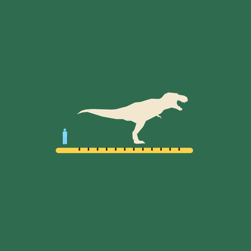
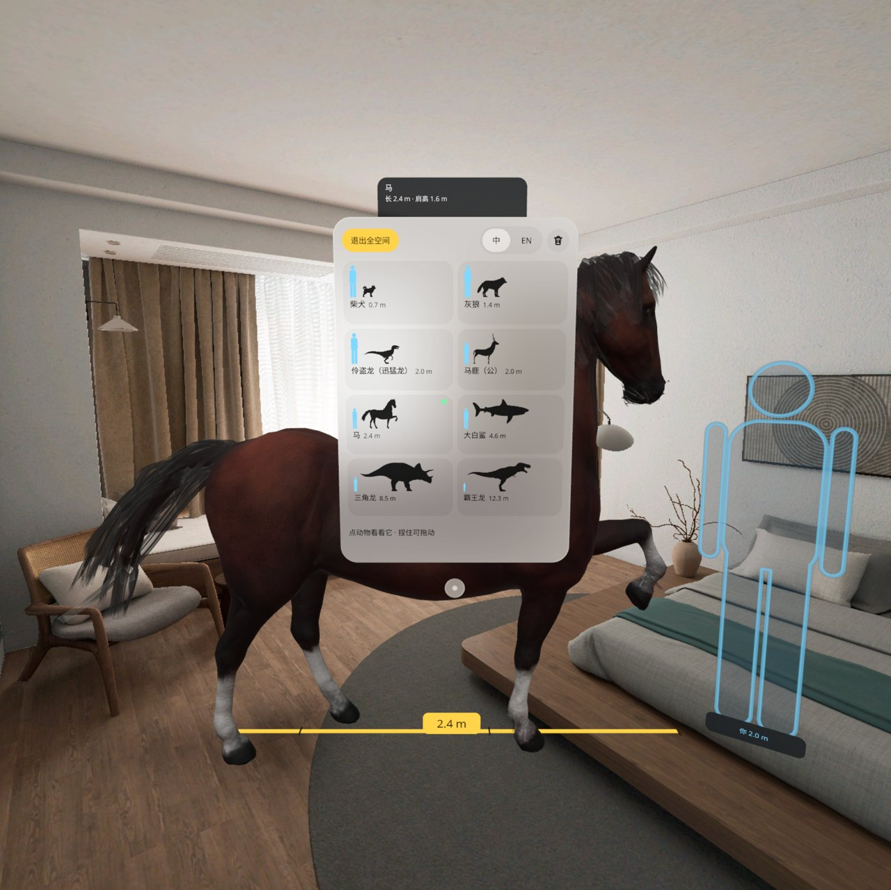
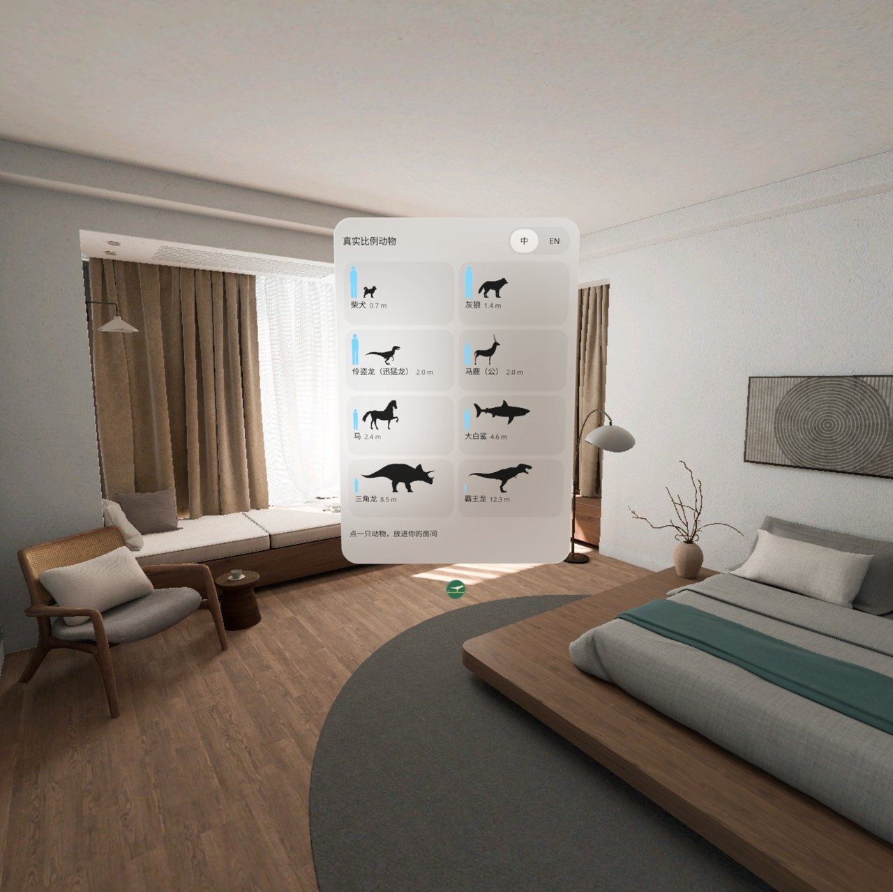
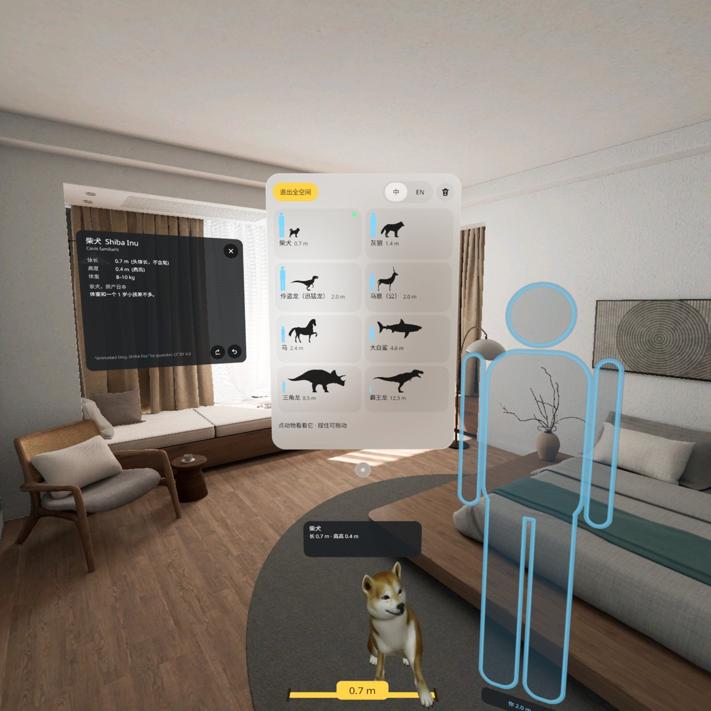
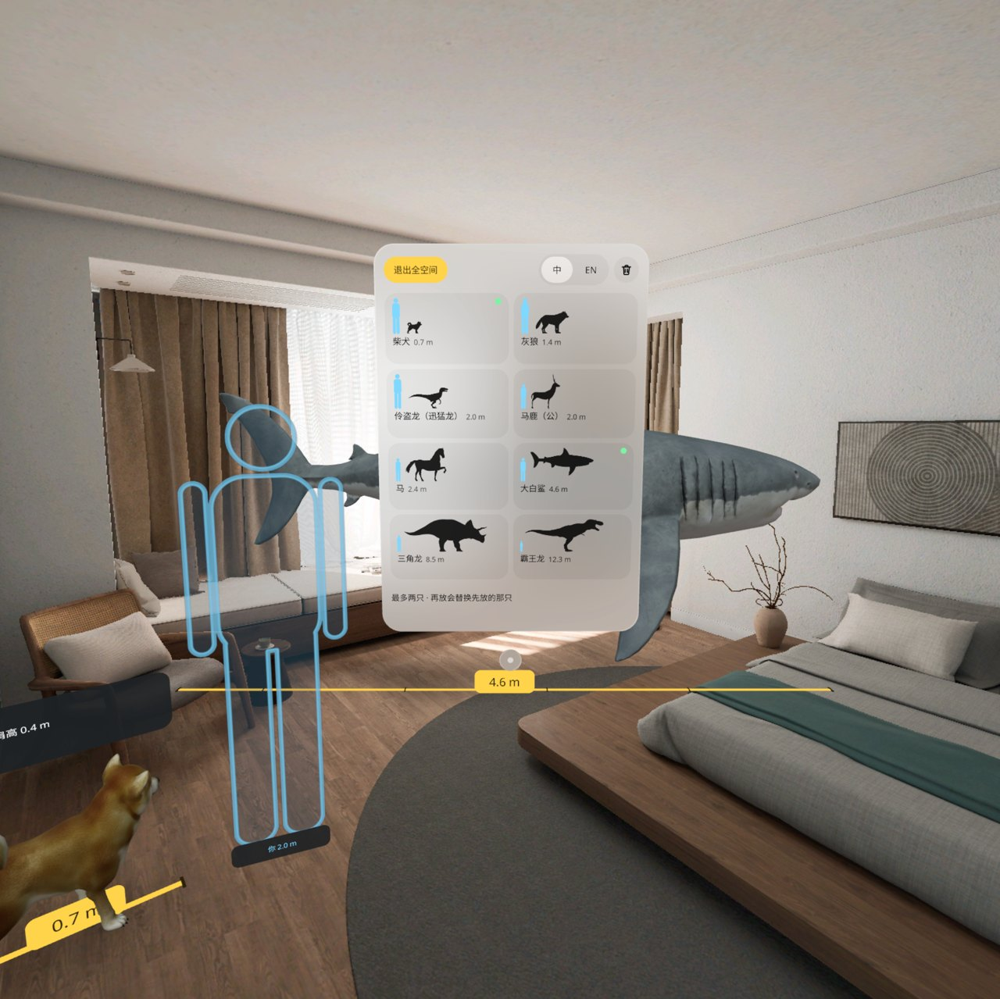
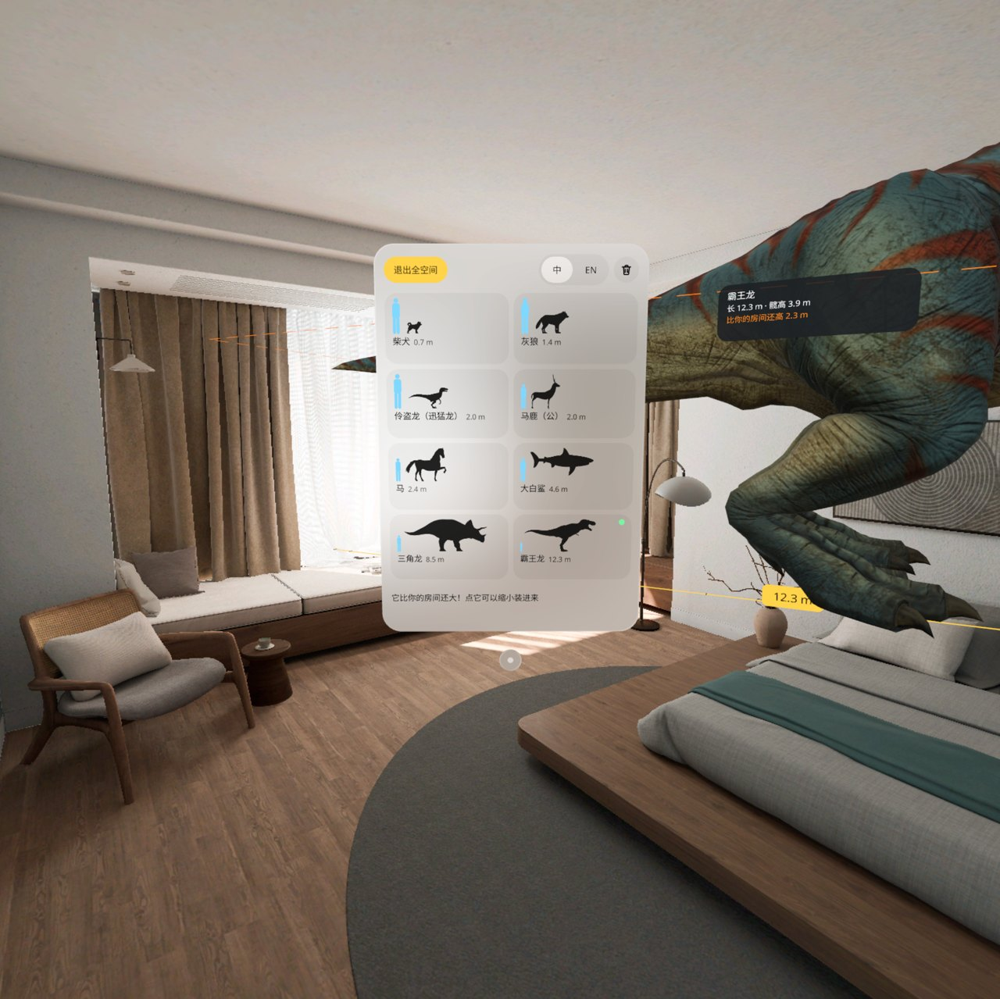
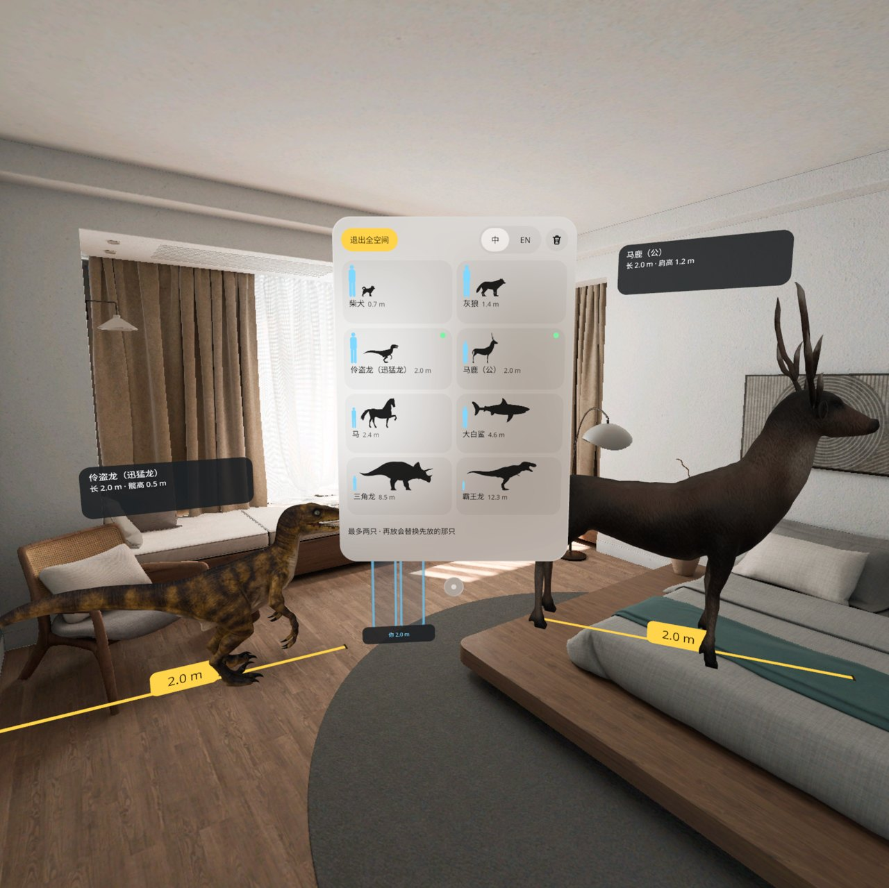
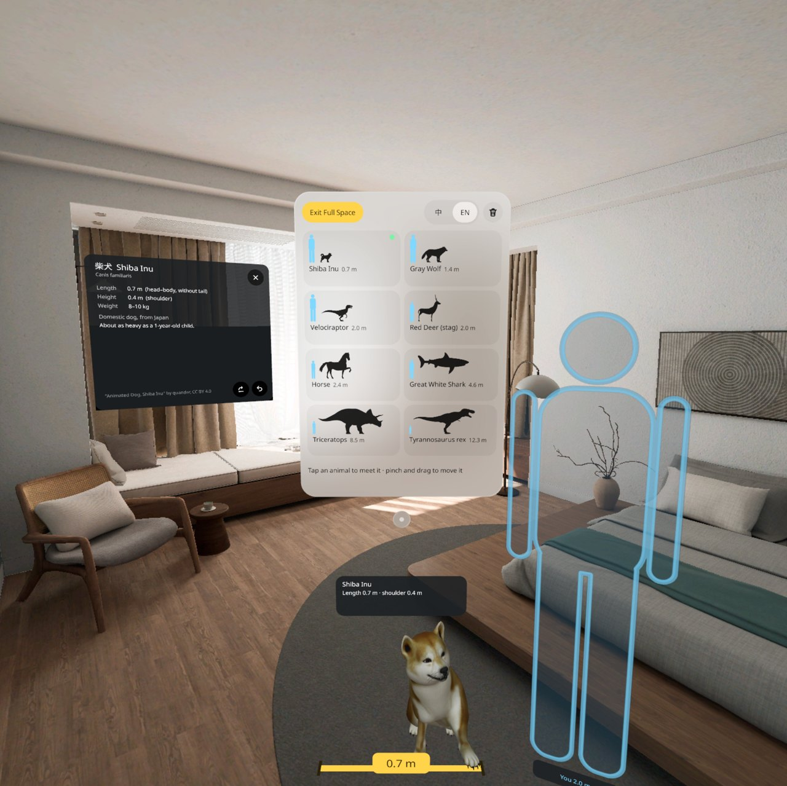
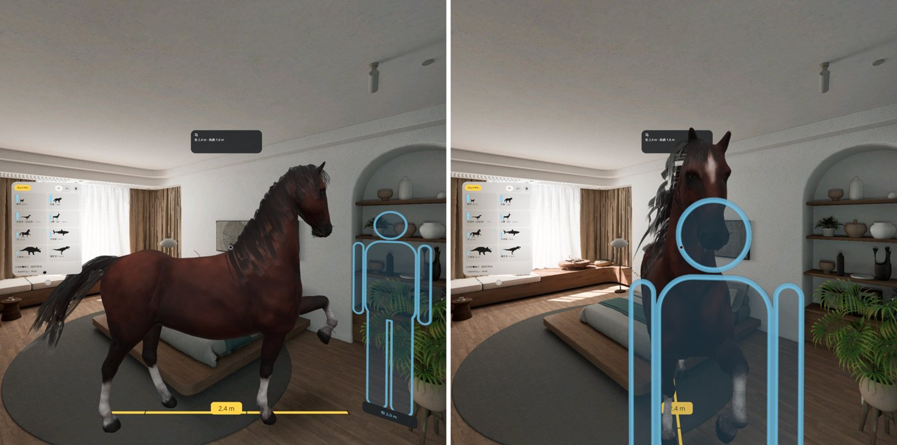
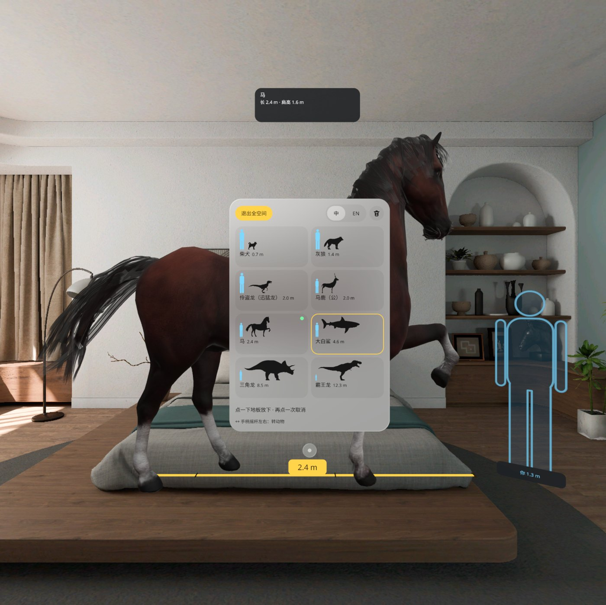

# 真实比例动物 · Life-size Creatures





> 截图和演示视频都来自 PICO 6.1 模拟器，用调试命令驱动，**不是真实手势录像**。v0.1.2 已在 PICO Swan 头显上由用户试过，确认可用。
> Screenshots and the demo video come from the PICO 6.1 emulator, driven by debug commands. **They are not recordings of real hand input.** v0.1.2 has been tried on a PICO Swan headset and confirmed working by the user.

## 中文

把 5 米长的大白鲨放进客厅，跟自己比一比。

图鉴是共享空间里的一扇普通窗口，可以和别的应用并排放着。点一只动物，应用进入全空间，点一下地板，它就按真实大小站在你的地板上：

- 地上一条黄色卷尺，量出它有多长；
- 旁边站着一个和你一样高的「你」；
- 比房间还高时，天花板上画一圈虚线，告诉你「比你的房间还高 1.4 m」；也可以在信息卡里选「装进房间」缩小显示；
- 点动物，它转过来看你，弹出信息卡：中英名、学名、体长 / 高度 / 体重、栖息地、一句冷知识；
- 房间里最多两只，可以捏住拖动、转 90°、送回图鉴；
- **手柄摇杆左右推，转动物**（v0.1.1 新增）：转的是开着信息卡的那只，没开卡时转你视线最近的那只；轻推慢转，推到底每秒约 60°，松手平滑停下；图鉴底部有一行提示「↔ 手柄摇杆左右：转动物」；
- 点「退出全空间」回到共享空间。

8 只动物，从小到大：柴犬 0.7 m、灰狼 1.4 m、伶盗龙 2.0 m、马鹿 2.0 m、马 2.4 m、大白鲨 4.6 m、三角龙 8.5 m、霸王龙 12.3 m。中英双语，完全离线，不要账号，不保存任何数据。

包名 `io.embodit.lifesize` · PICO Spatial SDK 6.1.9 · 界面全部用 SpatialUI + PicoTheme · 开发说明见 `AGENTS.md`，设计包见 `design/design-package.json`。

## English

Put a 5-metre great white shark in your living room and stand next to it.

The field guide is an ordinary window in the Shared Space, so it can sit next to other apps. Pick an animal and the app enters the Full Space; tap the floor and the animal stands there at its true size:

- a yellow tape on the floor reads its length;
- a figure of your own height stands beside it;
- when it is taller than your room, a dashed line marks your ceiling and the tag says how much taller; the info card can also shrink it to fit the room;
- tap the animal and it turns to look at you, with an info card: names in Chinese and English, Latin name, length / height / weight, habitat and one fun fact;
- up to two animals at once; pinch to drag, turn 90°, or send one back to the guide;
- **push a controller thumbstick left or right to turn an animal** (new in v0.1.1): it turns the animal whose info card is open, otherwise the one nearest your gaze; a light push turns slowly, a full push about 60° a second, and it eases to a stop when you let go; a hint at the foot of the guide reads "↔ thumbstick left / right: turn the animal";
- "Exit Full Space" returns to the Shared Space.

Eight animals, smallest first: Shiba Inu 0.7 m, gray wolf 1.4 m, velociraptor 2.0 m, red deer 2.0 m, horse 2.4 m, great white shark 4.6 m, triceratops 8.5 m, Tyrannosaurus rex 12.3 m. Chinese and English, fully offline, no account, nothing stored.

Package `io.embodit.lifesize` · PICO Spatial SDK 6.1.9 · all 2D UI is SpatialUI + PicoTheme · developer notes in `AGENTS.md`, design package in `design/design-package.json`.

## 截图 · Screenshots

| | |
|---|---|
| <br>图鉴窗在共享空间 · The field guide in the Shared Space | <br>柴犬转身 + 信息卡 · The Shiba turns to you, with its info card |
| <br>大白鲨和柴犬同框 · A great white shark and a Shiba Inu | <br>霸王龙比房间还大 · The T. rex is bigger than the room |
| <br>伶盗龙和马鹿 · A velociraptor and a red deer | <br>英文界面 · English UI |
| <br>摇杆推右：马从侧身转到面朝你 · Thumbstick right: the horse turns from side-on to face you | <br>图鉴底部的摇杆提示 · The thumbstick hint at the foot of the guide |

演示视频 Demo video: [`docs/LifeSizeCreatures-demo.mp4`](docs/LifeSizeCreatures-demo.mp4)（53 s，1080 × 1080，无声 / no sound；模拟器 + 调试命令，非真实手势录像 / emulator + debug commands, not real hand input）。视频录的是 v0.1.0，没有摇杆转动这一段。The video shows v0.1.0 and does not include the thumbstick turn.

## 安装与启动 · Install and launch

从 Release 下载 APK（debug 签名），然后：
Download the APK (debug-signed) from the Release, then:

```bash
adb install -r LifeSizeCreatures-v0.1.2.apk
pico-cli app launch io.embodit.lifesize
```

从源码构建 Build from source: `tools/dev.sh build`（需要 JDK 21 和 Android SDK / needs JDK 21 and the Android SDK）。

## 模型与许可 · Credits

8 个 3D 模型全部是 **CC BY 4.0**（https://creativecommons.org/licenses/by/4.0/），通过 Objaverse 镜像取自 Sketchfab，许可已对 Sketchfab API 核对。**有修改：** 狼、马、霸王龙的材质从 spec-gloss 转为 metal-rough；所有模型在应用里按真实尺寸缩放并调整朝向。每只动物的署名也显示在应用内信息卡底部。

All eight 3D models are **CC BY 4.0** (https://creativecommons.org/licenses/by/4.0/), obtained through the Objaverse mirror of Sketchfab, with the license checked on the Sketchfab API. **Modified:** materials converted from spec-gloss to metal-rough where needed (wolf, horse, T. rex); every model is scaled to true size and re-oriented in the app. Each credit is also shown at the foot of the animal's info card.

| 动物 Animal | 模型 Model | 作者 Author | 许可 License | 来源 Source |
|---|---|---|---|---|
| 柴犬 Shiba Inu | "Animated Dog, Shiba Inu" | quander | CC BY 4.0 | https://sketchfab.com/3d-models/9abfce885a834399b2c3ccaed51cd474 |
| 灰狼 Gray wolf | "Gray Wolf" | hamidkhan224 | CC BY 4.0 | https://sketchfab.com/3d-models/a2832b845e4e4edd9d439342cf4fd590 |
| 伶盗龙 Velociraptor | "Velociraptor" | Tomas Ibar | CC BY 4.0 | https://sketchfab.com/3d-models/b227da6c817043ab9a249dbbd127db67 |
| 马鹿 Red deer | "Deer" | aeonfitzgerald | CC BY 4.0 | https://sketchfab.com/3d-models/01f33919650c421e91666908db8c421e |
| 马 Horse | "The horse" | Carlos Villalba | CC BY 4.0 | https://sketchfab.com/3d-models/1483a55c785d4379a25441681153cfce |
| 大白鲨 Great white shark | "White Pointer" | VFX Stevenz | CC BY 4.0 | https://sketchfab.com/3d-models/8e429052939a4677861d0d550a0e27cd |
| 三角龙 Triceratops | "Triceratops dinosaur" | wojciechmiedziocha | CC BY 4.0 | https://sketchfab.com/3d-models/87527079bad44917ab1b98a456b46c7e |
| 霸王龙 T. rex | "Randaling T- Rex, animated!" | quander | CC BY 4.0 | https://sketchfab.com/3d-models/09a3632365344a99bb88e3dd0b684c89 |

字体 Fonts: Noto Sans and Noto Sans SC (subset), SIL Open Font License 1.1 (`third_party/`).

模型的已知局限 Known model caveats: 马鹿是通用雄鹿模型，不专门是马鹿；伶盗龙是无羽毛的「电影版」；按真实体长缩放后伶盗龙比名录高 39 %、霸王龙高约 30 %，有更好的 CC0 / CC BY 模型时替换。The deer is a generic antlered stag, not specifically a red deer; the velociraptor is a featherless "movie" raptor; scaled to the true length, the raptor (+39 %) and the T. rex (about +30 %) stand taller than the roster's top height — both are flagged for replacement when better CC0 / CC BY models are found.

## 已知问题 · Known issues

- 动物转到面朝你时，「你」剪影会挡在你和动物之间（剪影按设计站在动物鼻尖前 0.4 m）。When an animal turns to face you, the "you" figure stands between you and the animal (by design it stands 0.4 m beyond the snout).
- 三角龙同时比房间高又比房间长时，尺寸签只写「还高」。When the triceratops is both taller and longer than the room, the size tag only says how much taller.
- 尺寸签有时被图鉴窗挡住一角：系统总把窗口画在全空间内容前面，挪开图鉴窗即可。The guide window can cover a corner of a size tag, because the system draws windows in front of Full Space content; move the window aside.
- 点动物时的叫声还没有，现在播的是系统提示音。There is no animal call yet; tapping an animal plays a system sound.

## 真机 · On a headset

v0.1.2 已装在 PICO Swan 上，由用户试过并确认可用（2026-10-22）。下次戴上时可以顺手再看三件事：摇杆的方向与手感；一边推摇杆一边拖同一只时开始拖那一下会不会跳；先开应用、后拿起手柄时摇杆能不能马上用。v0.1.2 has been installed on a PICO Swan and confirmed working by the user (2026-10-22). Worth a look next time: the thumbstick's direction and feel; whether an animal jumps when you start dragging it while turning it; and whether the thumbstick works straight away if you pick the controller up after the app has started.
